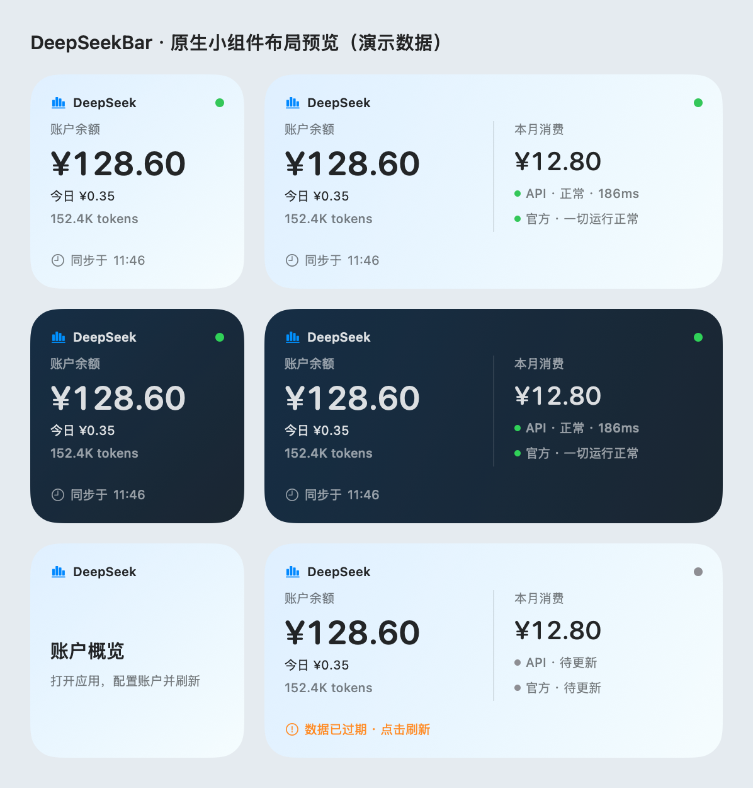

# DeepSeekBar

macOS 菜单栏与桌面小组件工具：一眼看清 DeepSeek 账户余额、消费用量与服务状态。可同时使用两个入口，也可隐藏菜单栏，只保留桌面小组件。

- **菜单栏**：DeepSeek 鲸鱼图标（官方 logo，template 模式自适应深浅色）+ 今日消费 · 今日 tokens（如 `¥0.35 · 152K`；极小金额显示四位小数；未配置平台凭证时回退显示总余额）
- **仅看小组件**：在设置的「菜单栏」中关闭「显示菜单栏图标和用量」，隐藏整个菜单栏入口，应用继续在后台刷新；此选择会保留到下次启动。
- **网络状态提示**：尚未探测或正常时鲸鱼保持系统默认颜色，API 探测缓慢或被限流时显示黄橙色，认证、HTTP 或网络探测异常时显示红色
- **下拉弹窗**：
  - 账户余额（总额 / 充值 / 赠送，可用性徽标）
  - 今日消费与 Flash/Pro 分项、本月消费（金额 + tokens）、搜索/抓取的今日与本月金额和调用次数、本月模型请求数、缓存命中率、主力模型、今日累计 token 折线图、近 7 日用量柱状图
  - 服务状态：API 主动探测（正常/缓慢/异常 + 延迟）+ 官方状态页（status.deepseek.com）结论与链接
- **自动刷新**：默认每 5 分钟（设置里可调 1–60 分钟）
- **macOS 桌面小组件**（默认包含，本机自用无需开发者账号）：通过系统「编辑小组件」添加小号 / 中号账户概览，展示余额、今日消费与 tokens，中号同时展示本月消费、API 与官方服务状态；点击打开账户概览并刷新。

## 界面预览

### 菜单栏

<p align="center">
  
</p>

### 弹出面板

<p align="center">
  
</p>

> 弹出面板截图中的账户、消费与用量数据均已脱敏；菜单栏截图按原图展示。

## 构建与运行

无需 Xcode，只需 Command Line Tools（`xcode-select --install`）：

### 编译并打包 App

在项目根目录执行：

```bash
./build_app.sh
```

该脚本会依次编译主应用和 WidgetKit 扩展、打包 App，并进行本地 ad-hoc 签名。构建产物位于：

- App：`<项目根目录>/DeepSeekBar.app`
- App 内可执行文件：`<项目根目录>/DeepSeekBar.app/Contents/MacOS/DeepSeekBar`
- SwiftPM 中间产物：`<项目根目录>/.build/release/DeepSeekBar`

每次重新执行 `./build_app.sh`，都会重新生成项目根目录下的 `DeepSeekBar.app`。

若本机 macOS 27 SDK 报 `SwiftUIMacros.StateMacro` 插件缺失，而同时装有 26.5 SDK，可仅为本次构建指定兼容 SDK（无需修改系统默认工具链）：

```bash
DEEPSEEKBAR_SDK_PATH=/Library/Developer/CommandLineTools/SDKs/MacOSX26.5.sdk ./build_app.sh
```

### 不安装，临时打开使用

无需复制到 `/Applications`。构建完成后，在项目根目录直接执行：

```bash
open ./DeepSeekBar.app
```

App 默认出现在 macOS 菜单栏；点击鲸鱼图标即可使用。隐藏菜单栏后，可点击桌面小组件或重新打开 DeepSeekBar 进入账户概览，通过底部的设置按钮恢复菜单栏显示。退出时点击概览底部的电源按钮。

如果需要在终端中直接观察运行日志，也可以以前台方式启动；按 `Control-C` 退出：

```bash
./DeepSeekBar.app/Contents/MacOS/DeepSeekBar
```

临时使用时不建议开启“登录时自动启动”。如需开机自启，请先将 `DeepSeekBar.app` 放在稳定位置（建议 `/Applications`），再在 App 设置中开启，避免移动或删除 App 后登录项失效。

> “今日累计 Token”折线由 App 在每次成功刷新时采样，并保留当天记录；DeepSeek 平台接口本身不提供分钟级历史。

## macOS 系统桌面小组件

支持 macOS 14 及以上的 WidgetKit 原生小组件，可从「编辑小组件」添加到桌面或通知中心。

<p align="center">
  
</p>

> 上图由 SwiftUI 离屏渲染，使用演示数据；并非系统小组件栏中的运行截图。

### 构建、安装与添加

**本机自用只需要 Command Line Tools，无需完整版 Xcode、Apple 开发者账号、Team ID 或开发者证书。** 默认构建使用本地 ad-hoc 签名，包含真正的 WidgetKit 扩展。

```bash
./build_app.sh
# 更新已有安装时，先从账户概览底部的电源按钮退出 DeepSeekBar。
./install_app.sh
open /Applications/DeepSeekBar.app
```

安装脚本将应用放到 `/Applications/DeepSeekBar.app`，校验完整签名，并向 LaunchServices 和 PlugInKit 注册扩展。要安装到个人应用目录，可执行 `DEEPSEEKBAR_INSTALL_DIR="$HOME/Applications" ./install_app.sh`。

1. 打开安装位置中的应用，配置凭据并完成一次刷新；已有凭据继续使用原来的 Keychain 条目。
2. 右键点击桌面 →「编辑小组件」，搜索 **DeepSeekBar**，选择「DeepSeek 账户概览」。
3. 添加小号或中号。小号显示余额、今日消费 / tokens 和 API 状态灯；中号增加本月消费以及 API / 官方状态详情。
4. 点击小组件可打开账户概览并刷新，也可以在设置的「桌面小组件」区手动同步。

### 只使用桌面小组件，隐藏菜单栏

1. 添加桌面小组件后，点击菜单栏鲸鱼图标或桌面小组件，打开账户概览。
2. 点击概览底部的齿轮按钮，进入设置。
3. 在「菜单栏」中关闭 **「显示菜单栏图标和用量」**。鲸鱼图标和用量文字会一起隐藏，应用继续在后台为小组件提供数据。

菜单栏默认显示。此开关立即生效并自动保存，无需点击凭据区的「保存」按钮；下次启动会沿用你的选择。

**恢复菜单栏显示：** 点击桌面小组件 → 概览底部的齿轮按钮 →「菜单栏」→ 开启「显示菜单栏图标和用量」。即使小组件已被移除，也可以从「应用程序」中重新打开 DeepSeekBar，进入账户概览后恢复显示。

若希望登录后自动在后台运行，可在设置的「启动」中开启「登录时自动启动」；请先将应用安装到稳定位置。

### 刷新与后台运行

隐藏菜单栏或关闭账户概览、设置窗口后，应用仍会继续刷新。要完全退出应用，点击账户概览底部的电源按钮；退出后，小组件将无法获取新数据。

系统负责小组件的实际更新时间，可能合并或延后刷新请求，参见 [Apple：保持小组件更新](https://developer.apple.com/documentation/widgetkit/keeping-a-widget-up-to-date/)。应用退出后，小组件下一次请求会显示打开应用的提示；当前已渲染的内容会保留到系统重新获取或时间线过期。时间线包含过期及午夜节点，避免旧的服务状态和昨日用量一直显示为当前数据。

### 为什么本机自用不需要开发者证书

采用与 `traex-status` 相同的本机通信方式：主应用只在 **127.0.0.1:47924** 提供展示快照，沙箱内的小组件通过 HTTP 读取。该端口与 Traex 的 47923 不同，两者可同时运行。快照仅包含余额、用量、状态及时间；不包含 API Key、平台 Token 或服务器原始响应，不写入共享文件。原生扩展使用 `_NSExtensionMain` 入口并保留 `_main`，主应用和扩展分别进行 ad-hoc 签名。

此方案不使用 App Group。接口只允许指定路径和方法，校验本机 Host 与专用请求头，拒绝带 Origin 的浏览器请求；不监听局域网地址。客户端不使用代理、缓存或 Cookie，也不跟随重定向。本机原生进程可以访问该只读展示接口，小组件不读取或共享账户凭据。

如果找不到小组件，重新执行安装脚本，并退出重开「编辑小组件」。可用 `pluginkit -m -v -i com.local.DeepSeekBar.Widget` 检查注册位置。设置中若提示连接失败，先退出项目目录和安装目录中的重复实例，再只打开安装目录中的应用。

默认 `./build_app.sh` 已包含小组件；`--with-widget` 和旧的 `--allow-ad-hoc` 参数保留兼容。仅需菜单栏版本时用 `./build_app.sh --without-widget`。当前流程面向本机源码构建；对外分发时的 Developer ID 签名和公证需另行配置。

## 两套凭据（重点）

DeepSeek 的余额和用量是**两个独立的鉴权体系**，本工具两者都用：

| 凭据 | 用途 | 获取方式 |
|---|---|---|
| API Key（`sk-...`） | 查余额（官方接口 `api.deepseek.com/user/balance`） | platform.deepseek.com →「API keys」创建 |
| 平台登录 Token | 查消费/用量明细（平台网页端内部接口 `/api/v0/usage/by_api_key/amount`、`/api/v0/usage/by_api_key/cost`） | App 内「打开登录窗口自动获取」（内嵌浏览器登录后自动捕获）；或手动：浏览器登录后 F12 Console 执行 `JSON.parse(localStorage.userToken).value` |

- 平台 Token 会过期；过期后弹窗会提示「重新登录」，一键打开登录窗口即可。
- 凭据存储在 macOS Keychain（service: `com.local.DeepSeekBar`）。注意：重新打包后首次访问可能弹一次钥匙串授权框（ad-hoc 签名所致），允许即可。
- 只配 API Key 也能用：会显示余额 + 服务状态，消费区提示登录。

## 模型用量支持

按 [DeepSeek 官方模型页面](https://api-docs.deepseek.com/zh-cn/quick_start/pricing/) 于 2026-09-23 的信息，当前 API 模型为 `deepseek-flash`（DeepSeek-V4.1-Flash）和 `deepseek-v4-pro`（DeepSeek-V4-Pro-0813）。

- **今日 Flash**：识别 `deepseek-flash`，兼容 `deepseek-v4-flash`、`deepseek-v4-flash-vision-exp`；保留历史账单中 `deepseek-chat`、`deepseek-reasoner` 的既有归类。官方说明旧 V4 Flash / Vision Exp 名称目前转由 V4.1 Flash 提供服务。
- **今日 Pro**：识别 `deepseek-v4-pro`。
- 识别时忽略大小写、名称前后空白，并兼容平台附加的 `[1m]` 等计费档位后缀。未知模型仍计入总用量和总消费，不强行归入 Flash / Pro；主力模型保留平台返回的原始名称。

消费金额直接取自平台账单接口，不按本地固定单价估算。

## Search / Fetch 消费

消费区增加「网页搜索与抓取」表格，按平台返回的工具名称，分别显示**今日 / 本月的金额与调用次数**。没有工具明细时显示空状态。表格下方可直接打开官方计费规则；弹窗内容较多时可滚动查看。

- **今日消费、本月消费、菜单栏和桌面小组件中的消费总额均包含工具费用**，不需要再加一次。Flash / Pro 分项仅统计模型费用；tokens、缓存命中率和主力模型也只使用模型数据。
- 「模型请求」只计本月模型请求；搜索 / 抓取次数单独显示。近 7 日的逐日消费包含模型及工具费用，token 图仍只显示模型 tokens。
- 根据 [DeepSeek 官方规则](https://api-docs.deepseek.com/zh-cn/guides/search/)（2026-10-27 核对），Search 与 Fetch 均为 **¥5 / 1,000 次成功且有结果的请求**；美元价格为 **$0.75 / 1,000 次**。失败、空结果、超时不收费。Harness / Claude Code / Codex 中的服务端工具调用从**北京时间 2026-11-01 00:00**起按次收费。
- 本应用始终读取平台实际账单，不按调用次数推算费用，也不硬编码免费期。因而免费或尚未扣费的调用可以显示次数与零金额；不会自动转换为收费。

目前使用平台新版按 API Key 分桶的账单接口，一次查询覆盖本月及完整近 7 日，合并全部 API Key；工具来自 `function_series` / `FUNCTION_CALL`，不依赖硬编码工具名称。查询与日期归属遵循平台当前时区偏移；月初的上月记录只进入近 7 日图表，不混入本月总额。金额优先选择账户余额所用币种（尚无余额时默认 CNY），该币种未返回则使用账单中的首个币种；不同币种不会相加。

合法空账单显示零用量；缺少必要字段或接口失败会报告错误，避免误显示为免费。这些接口仍是平台内部接口，并非公开 Search / Fetch 调用接口；本应用刷新账单不会发起付费搜索或网页抓取。

## 服务状态口径

- **API 探测**：`GET api.deepseek.com/models`，按响应码 + 延迟判定 正常(<2s)/缓慢/异常；未配置 Key 时做匿名探测（401 视为服务可达）。
- **官方状态页**：抓取 status.deepseek.com（FlashCat 托管），解析其服务端渲染的**总体状态徽章**（绿色对勾 = 一切正常）。不做全页关键词匹配（页面内嵌 i18n 字典和历史事件含"故障"字样，会误报）；页面结构无法识别时显示"未能判定"并给出链接，永不误报。

## 项目结构

```
Package.swift               # SPM，6 个 target
Sources/
  DeepSeekBarCore/          # 纯逻辑库（可独立测试）
    Models.swift            #   响应模型（防御式全可选解析）+ 领域模型
    DeepSeekClient.swift    #   余额/用量/探测/状态页 + 聚合
    UsageSeries.swift       #   新版模型/工具账单分桶解码、日期范围与归一化
  DeepSeekBar/              # 主应用（菜单栏入口可隐藏）
    DeepSeekBarApp.swift    #   @main 入口、菜单栏显示开关与独立概览场景
    AppState.swift          #   状态编排 + 定时刷新
    KeychainStore.swift     #   Keychain 凭据
    MenuPopoverView.swift   #   下拉弹窗
    ToolUsageView.swift     #   搜索/抓取今日与本月金额、调用次数
    LoginWindowView.swift   #   登录窗口
    WebView.swift           #   WKWebView + JS 注入捕获平台 Token
    SettingsView.swift      #   设置
    WidgetLinkHandler.swift #   小组件链接与应用重新打开，支持菜单栏隐藏及冷启动
  DeepSeekBarWidgetShared/  # 展示快照、回环客户端、请求校验、跨日及过期逻辑
  DeepSeekBarWidgetBridge/  # 仅主应用使用的本机 HTTP 快照服务
  DeepSeekBarWidget/        # 原生 WidgetKit 扩展，小号 / 中号卡片及时间线
  SelfTest/main.swift       # 自测（CLT 无 XCTest，用退出码断言）
  SelfTest/ModelSupportTests.swift # 当前模型、兼容别名与账单聚合回归测试
  SelfTest/SearchBillingTests.swift # 搜索/抓取账单、跨月、多 Key、币种和错误回归
  SelfTest/WidgetTests.swift # 小组件快照、请求校验与时间边界测试
  SelfTest/WidgetBridgeTests.swift # 本机通信集成测试
WidgetExtension/           # 扩展声明与沙箱网络客户端权限
build_app.sh                # 主应用 + 小组件打包脚本
install_app.sh              # 安装应用并注册扩展
```

## 自测

```bash
swift run SelfTest            # 离线：解析/聚合/状态页判定/小组件快照与时间边界
swift run SelfTest --widget-bridge # 本机 HTTP 集成：读取/拒绝浏览器请求/重复实例/退出，无外网或凭据
swift run SelfTest --network  # 加真实网络：匿名探测、401 映射、假 Token 校验、状态页抓取
scripts/test_popover_layout.sh # 原生弹窗尺寸协商、滚动与状态切换回归（无账户或网络访问）
```

弹窗测试覆盖仅给宽度及压缩高度的菜单栏布局，运行方法和 SDK 选择见 [界面回归说明](Tests/PopoverLayout/README.md)。

## 注意事项

- 用量接口是 DeepSeek 平台前端**内部接口**（无官方文档/SLA），可能随时变更；代码会检查响应信封和必要统计字段，并提供手动粘贴 Token 兜底。
- 内部接口 HTTP 恒为 200，成败看 body 的 `code`/`biz_code`；`40002/40003` = Token 缺失或失效。
- 请求频率请保持克制（默认 5 分钟），收到 429 应拉长间隔。
