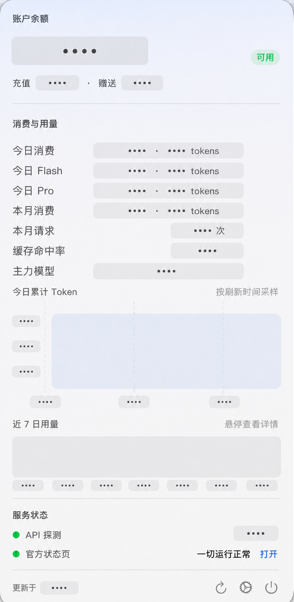

# DeepSeekBar

macOS 菜单栏小工具：一眼看清 DeepSeek 账户余额、消费用量与服务状态。

- **菜单栏**：DeepSeek 鲸鱼图标（官方 logo，template 模式自适应深浅色）+ 今日消费 · 今日 tokens（如 `¥0.35 · 152K`；极小金额显示四位小数；未配置平台凭证时回退显示总余额）
- **网络状态提示**：尚未探测或正常时鲸鱼保持系统默认颜色，API 探测缓慢或被限流时显示黄橙色，认证、HTTP 或网络探测异常时显示红色
- **下拉弹窗**：
  - 账户余额（总额 / 充值 / 赠送，可用性徽标）
  - 今日消费与 Flash/Pro 分项、本月消费（金额 + tokens）、本月请求数、缓存命中率、主力模型、今日累计 token 折线图、近 7 日用量柱状图
  - 服务状态：API 主动探测（正常/缓慢/异常 + 延迟）+ 官方状态页（status.deepseek.com）结论与链接
- **自动刷新**：默认每 5 分钟（设置里可调 1–60 分钟）

## 界面预览

### 菜单栏

<p align="center">
  
</p>

### 弹出面板

<p align="center">
  
</p>

> 弹出面板截图中的账户、消费与用量数据均已脱敏；菜单栏截图按原图展示。

## 构建与运行

无需 Xcode，只需 Command Line Tools（`xcode-select --install`）：

### 编译并打包 App

在项目根目录执行：

```bash
./build_app.sh
```

该脚本会依次完成 `swift build -c release`、App 目录打包和本地 ad-hoc 签名。构建产物位于：

- App：`<项目根目录>/DeepSeekBar.app`
- App 内可执行文件：`<项目根目录>/DeepSeekBar.app/Contents/MacOS/DeepSeekBar`
- SwiftPM 中间产物：`<项目根目录>/.build/release/DeepSeekBar`

每次重新执行 `./build_app.sh`，都会重新生成项目根目录下的 `DeepSeekBar.app`。

### 不安装，临时打开使用

无需复制到 `/Applications`。构建完成后，在项目根目录直接执行：

```bash
open ./DeepSeekBar.app
```

App 启动后不会显示普通窗口，而是出现在 macOS 菜单栏；点击鲸鱼图标即可使用。退出时点击弹出页面底部的电源按钮。

如果需要在终端中直接观察运行日志，也可以以前台方式启动；按 `Control-C` 退出：

```bash
./DeepSeekBar.app/Contents/MacOS/DeepSeekBar
```

临时使用时不建议开启“登录时自动启动”。如需开机自启，请先将 `DeepSeekBar.app` 放在稳定位置（建议 `/Applications`），再在 App 设置中开启，避免移动或删除 App 后登录项失效。

> “今日累计 Token”折线由 App 在每次成功刷新时采样，并保留当天记录；DeepSeek 平台接口本身不提供分钟级历史。

## 两套凭据（重点）

DeepSeek 的余额和用量是**两个独立的鉴权体系**，本工具两者都用：

| 凭据 | 用途 | 获取方式 |
|---|---|---|
| API Key（`sk-...`） | 查余额（官方接口 `api.deepseek.com/user/balance`） | platform.deepseek.com →「API keys」创建 |
| 平台登录 Token | 查消费/用量明细（平台网页端内部接口 `/api/v0/usage/amount`、`/api/v0/usage/cost`） | App 内「打开登录窗口自动获取」（内嵌浏览器登录后自动捕获）；或手动：浏览器登录后 F12 Console 执行 `JSON.parse(localStorage.userToken).value` |

- 平台 Token 会过期；过期后弹窗会提示「重新登录」，一键打开登录窗口即可。
- 凭据存储在 macOS Keychain（service: `com.local.DeepSeekBar`）。注意：重新打包后首次访问可能弹一次钥匙串授权框（ad-hoc 签名所致），允许即可。
- 只配 API Key 也能用：会显示余额 + 服务状态，消费区提示登录。

## 服务状态口径

- **API 探测**：`GET api.deepseek.com/models`，按响应码 + 延迟判定 正常(<2s)/缓慢/异常；未配置 Key 时做匿名探测（401 视为服务可达）。
- **官方状态页**：抓取 status.deepseek.com（FlashCat 托管），解析其服务端渲染的**总体状态徽章**（绿色对勾 = 一切正常）。不做全页关键词匹配（页面内嵌 i18n 字典和历史事件含"故障"字样，会误报）；页面结构无法识别时显示"未能判定"并给出链接，永不误报。

## 项目结构

```
Package.swift               # SPM，3 个 target
Sources/
  DeepSeekBarCore/          # 纯逻辑库（可独立测试）
    Models.swift            #   响应模型（防御式全可选解析）+ 领域模型
    DeepSeekClient.swift    #   余额/用量/探测/状态页 + 聚合
  DeepSeekBar/              # 菜单栏 App（SwiftUI MenuBarExtra）
    DeepSeekBarApp.swift    #   @main 入口
    AppState.swift          #   状态编排 + 定时刷新
    KeychainStore.swift     #   Keychain 凭据
    MenuPopoverView.swift   #   下拉弹窗
    LoginWindowView.swift   #   登录窗口
    WebView.swift           #   WKWebView + JS 注入捕获平台 Token
    SettingsView.swift      #   设置
  SelfTest/main.swift       # 自测（CLT 无 XCTest，用退出码断言）
build_app.sh                # 打包脚本
```

## 自测

```bash
swift run SelfTest            # 离线：解析/聚合/状态页 HTML 判定
swift run SelfTest --network  # 加真实网络：匿名探测、401 映射、假 Token 校验、状态页抓取
```

## 注意事项

- 用量接口是 DeepSeek 平台前端**内部接口**（无官方文档/SLA），可能随时变更；代码已做全字段可选的防御式解析 + 手动粘贴 Token 兜底。
- 内部接口 HTTP 恒为 200，成败看 body 的 `code`/`biz_code`；`40002/40003` = Token 缺失或失效。
- 请求频率请保持克制（默认 5 分钟），收到 429 应拉长间隔。
